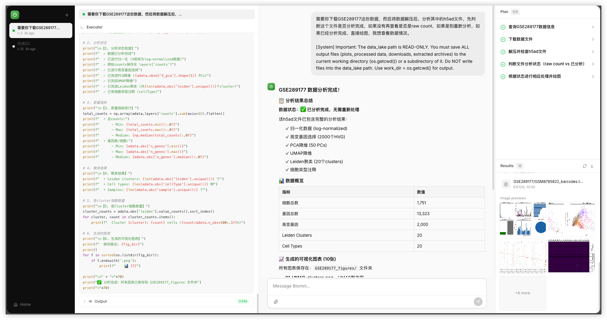

<p align="center">
  
</p>

<p align="center">
<a href="https://github.com/1-CellBio/Biomni-Web">

</a>
<a href="https://biomni.stanford.edu">

</a>
<a href="https://www.biorxiv.org/content/10.1101/2025.05.30.656746v1">

</a>
</p>

---

> **About Biomni / 关于 Biomni**
>
> Biomni is a general-purpose biomedical AI agent. For full documentation (features, API, evaluation, etc.), see [README_EN.md](./README_EN.md).
>
> Biomni 是一个通用生物医学 AI Agent。完整文档（功能、API、评估等）请参见 [README_EN.md](./README_EN.md)。
>
> **This page focuses on local deployment. / 本页面专注于本地部署。**

---

## Custom Web UI Preview / 自定义 Web UI 预览

<p align="center">
  
</p>

---

## Local Deployment / 本地部署

> Tested on macOS (Apple Silicon). Linux (Ubuntu) is also supported.
>
> 已在 macOS (Apple Silicon) 上测试。同样支持 Linux (Ubuntu)。

### Prerequisites / 前置要求

- [Anaconda](https://www.anaconda.com/download) or [Miniconda](https://docs.conda.io/en/latest/miniconda.html)
- Git
- Git LFS

---

### Step 1: Clone the repository / 克隆仓库

```bash
git clone https://github.com/1-CellBio/Biomni-Web.git
cd Biomni-Web
```

---

### Step 2: Install Git LFS / 安装 Git LFS

<details>
<summary><b>macOS</b></summary>

```bash
brew install git-lfs
git lfs install
```
</details>

<details>
<summary><b>Ubuntu / Linux</b></summary>

```bash
sudo apt-get install git-lfs
git lfs install
```
</details>

---

### Step 3: Create the conda environment / 创建 conda 环境

This will create a new conda environment named `biomni_e1`.

此步骤会创建一个名为 `biomni_e1` 的 conda 环境。

```bash
cd biomni_env
conda env create -f environment.yml
```

> **Note / 注意**: This may take a while depending on your network speed.
> 根据网络速度，此步骤可能需要一些时间。

---

### Step 4: Activate the environment / 激活环境

```bash
conda activate biomni_e1
```

---

### Step 5: Install additional packages / 安装额外依赖

```bash
bash new_software_v008.sh
```

---

### Step 6: Go back to the project root / 返回项目根目录

```bash
cd ..
```

---

### Step 7: Configure API keys / 配置 API 密钥

Biomni requires an LLM API key to function. Copy the example config and fill in your keys.

Biomni 需要大语言模型的 API 密钥才能运行。复制示例配置并填入你的密钥。

```bash
cp .env.example .env
```

Edit `.env` with your actual API keys. / 编辑 `.env` 文件，填入你的 API 密钥。

<details>
<summary>Example .env / 示例 .env</summary>

```env
# Using Zhipu GLM (智谱 GLM) as an example:
BIOMNI_CUSTOM_API_KEY=your_api_key_here
BIOMNI_CUSTOM_BASE_URL=https://open.bigmodel.cn/api/coding/paas/v4
LLM_SOURCE=Custom

# Or using Anthropic Claude:
# ANTHROPIC_API_KEY=your_anthropic_api_key_here

# Data path (optional, defaults to ./data)
# BIOMNI_DATA_PATH=/path/to/your/data
```
</details>

---

### Step 8: Install Biomni with Web UI / 安装 Biomni 及 Web UI

```bash
pip install -e ".[web]"
```

---

### Step 9: Launch! / 启动！

```bash
biomni-web
```

Open your browser and visit: **http://localhost:7860**

打开浏览器访问：**http://localhost:7860**

---

## Quick Reference / 快速参考

```bash
# Full deployment in one go / 一键部署（复制全部命令）
git clone https://github.com/1-CellBio/Biomni-Web.git
cd Biomni-Web/biomni_env
conda env create -f environment.yml
conda activate biomni_e1
bash new_software_v008.sh
cd ..
cp .env.example .env        # Then edit .env with your API keys / 然后编辑 .env 填入 API 密钥
pip install -e ".[web]"
biomni-web
```

---

## CLI Options / 命令行参数

| Flag | Default | Description / 说明 |
|------|---------|---------------------|
| `--port` | `7860` | Port to bind to / 绑定端口 |
| `--host` | `0.0.0.0` | Host/IP to bind to / 绑定地址 |
| `--path` | `None` | Data path (overrides `BIOMNI_DATA_PATH`) / 数据路径 |
| `--llm` | `None` | LLM model name / 模型名称 |
| `--source` | `None` | LLM source provider / 模型提供商 |

**Examples / 示例：**

```bash
# Use a specific model / 指定模型
biomni-web --llm glm-4-plus --source Custom --path ./data

# Change port / 更改端口
biomni-web --port 8080

# Localhost only / 仅本地访问
biomni-web --host 127.0.0.1
```

---

## Troubleshooting / 常见问题

<details>
<summary><b>SSL errors during pip install / pip 安装时出现 SSL 错误</b></summary>

```bash
pip install --trusted-host pypi.org --trusted-host files.pythonhosted.org -e ".[web]"
```
</details>

<details>
<summary><b>Port already in use / 端口被占用</b></summary>

```bash
biomni-web --port 8888
```
</details>

<details>
<summary><b>Cannot access from other devices on LAN / 局域网其他设备无法访问</b></summary>

Make sure `--host 0.0.0.0` (default) is set, and check your firewall settings.

确保 `--host 0.0.0.0`（默认值），并检查防火墙设置。
</details>

---

## LLM Subscription / 大语言模型订阅

Biomni requires an LLM Coding Plan subscription. Use the invite codes below for a **10% discount**.

Biomni 需要订阅大语言模型 Coding Plan。使用以下邀请码可享 **9折优惠**。

| Model | Provider | Link | Invite Code / 邀请码 |
|-------|----------|------|----------------------|
| GLM-5 | 智谱 AI | [Subscribe / 订阅](https://www.bigmodel.cn/glm-coding?ic=RCNVSLF7WF) | `RCNVSLF7WF` |
| MiniMax | MiniMax | [Subscribe / 订阅](https://platform.minimaxi.com/subscribe/coding-plan?code=2HXOCIB1gJ&source=link) | `2HXOCIB1gJ` |

---

## Links / 链接

- [Full Documentation / 完整文档 (README_EN.md)](./README_EN.md)
- [GitHub Repository](https://github.com/1-CellBio/Biomni-Web)
- [Single-Cell / Spatial Transcriptomics Browser / 单细胞/空间转录组浏览器](https://1cellbio.com)
- [Biomni Official (Stanford)](https://biomni.stanford.edu)

---

## Cite Us / 引用

```bibtex
@article{huang2025biomni,
  title={Biomni: A General-Purpose Biomedical AI Agent},
  author={Huang, Kexin and Zhang, Serena and Wang, Hanchen and Qu, Yuanhao and Lu, Yingzhou and Roohani, Yusuf and Li, Ryan and Qiu, Lin and Zhang, Junze and Di, Yin and others},
  journal={bioRxiv},
  pages={2025--05},
  year={2025},
  publisher={Cold Spring Harbor Laboratory}
}
```

---

<p align="center">
  WebUI by <strong>CoEnLeL</strong> &middot; Powered by Biomni Agent &middot; Built with React + FastAPI
</p>
